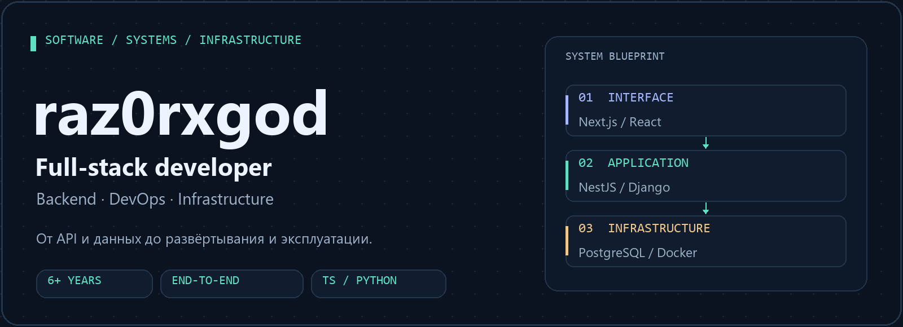
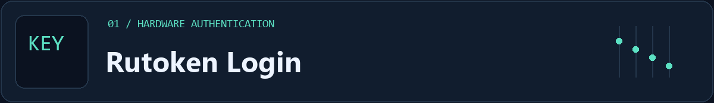
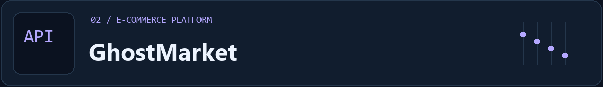
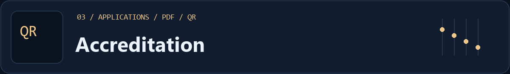
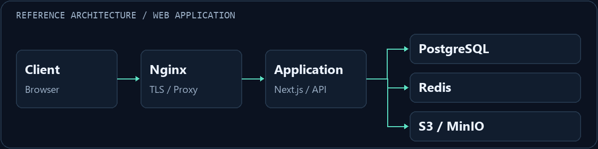

<!-- Profile README for github.com/raz0rxgod. Assets are stored in this repository. -->

  
  
<strong>Создаю веб-приложения и инфраструктуру, на которой они работают.</strong>

  
TypeScript / Python · API и базы данных · Linux / Windows Server

  
<a href="#projects">Проекты</a> &nbsp; / &nbsp; <a href="#stack">Стек</a> &nbsp; / &nbsp; <a href="#approach">Подход</a> &nbsp; / &nbsp; <a href="https://t.me/koksedram">Написать в Telegram ↗</a>

<h2>Разработка с пониманием эксплуатации</h2>

Я full-stack разработчик с <strong>6+ годами практического опыта</strong> в разработке, автоматизации и эксплуатации IT-систем. Работаю на стыке backend, frontend и инфраструктуры: проектирую API и структуру данных, создаю интерфейсы, настраиваю окружение и развёртывание.

Мне интересны задачи, где нужно разобраться в системе целиком: от авторизации и бизнес-логики до reverse proxy, диагностики и поддержки legacy-кода.

<table>
  <tr><th align="left">Разработка</th><th align="left">Данные</th><th align="left">Эксплуатация</th></tr>
  <tr>
    <td valign="top">REST API, интерфейсы, аутентификация, роли и интеграции</td>
    <td valign="top">Схемы БД, миграции, индексы, транзакции и оптимизация SQL</td>
    <td valign="top">Docker, Nginx, HTTPS, автоматизация и диагностика</td>
  </tr>
</table>

<h2>Избранные проекты</h2>

<strong>Беспарольный вход в Django с USB-токеном Рутокен.</strong> Интеграция аппаратной криптографии в стандартный механизм аутентификации Django.

<ul>
  <li>Challenge/response: носитель подписывает запрос, сервер проверяет подпись по сертификату X.509.</li>
  <li>Закрытый ключ остаётся на устройстве; взаимодействие с ним идёт через браузерный плагин.</li>
  <li>В README проекта описана проверка на реальном устройстве; протокол и нюансы интеграции разобраны в документации.</li>
</ul>

<code>Python</code> <code>Django</code> <code>X.509</code> <code>RSA / ECDSA</code> <code>Redis</code>

<a href="https://github.com/raz0rxgod/rutoken-login-form"><strong>Код ↗</strong></a> &nbsp; · &nbsp; <a href="https://github.com/raz0rxgod/rutoken-login-form/blob/main/docs/RUTOKEN_LOGIN.md">Протокол и интеграция</a>

<strong>Интернет-магазин с каталогом, заказами и административной панелью.</strong> Проект объединяет клиентскую часть, backend и инфраструктуру развёртывания.

<ul>
  <li>Каталог с категориями, брендами и атрибутами; корзина, избранное и оформление заказов.</li>
  <li>JWT-аутентификация с refresh-токенами и ролями ADMIN / MANAGER / EDITOR / CUSTOMER.</li>
  <li>Загрузка и обработка изображений через Multer + Sharp; PostgreSQL, Redis и S3-совместимое хранилище.</li>
</ul>

<code>Next.js</code> <code>React</code> <code>NestJS</code> <code>Prisma</code> <code>PostgreSQL</code> <code>Docker</code>

<a href="https://github.com/raz0rxgod/ghostmarket"><strong>Код ↗</strong></a> &nbsp; · &nbsp; <a href="https://github.com/raz0rxgod/ghostmarket/blob/main/docs/PROJECT_STATUS.md">Технический статус</a> &nbsp; · &nbsp; <a href="https://github.com/raz0rxgod/ghostmarket/blob/main/docs/DEPLOY.md">Развёртывание</a>

<strong>Портал электронной аккредитации.</strong> Работа с групповыми заявками, документами участников и проверкой аккредитационных карт на пунктах пропуска.

<ul>
  <li>Личный кабинет заявителя и рассмотрение заявок сотрудниками с разными ролями.</li>
  <li>Чат заявителя с администрацией через REST / WebSocket.</li>
  <li>Именные PDF-карты с QR-кодом, проверка QR и журнал сканирований.</li>
</ul>

<code>Next.js</code> <code>NestJS</code> <code>PostgreSQL</code> <code>WebSocket</code> <code>MinIO</code> <code>Docker</code>

<a href="https://github.com/raz0rxgod/accreditation"><strong>Код ↗</strong></a> &nbsp; · &nbsp; <a href="https://github.com/raz0rxgod/accreditation/blob/main/docs/PROJECT_STATUS.md">Технический статус</a> &nbsp; · &nbsp; <a href="https://github.com/raz0rxgod/accreditation/blob/main/docs/DEPLOY.md">Развёртывание</a>

<h2>Технологии и инструменты</h2>

<strong>Основной стек публичных проектов</strong>

<table>
  <tr><th align="left">Направление</th><th align="left">Технологии</th></tr>
  <tr><td>Backend</td><td>TypeScript · Node.js · NestJS · Python · Django · REST API</td></tr>
  <tr><td>Frontend</td><td>React · Next.js · JavaScript · HTML / CSS · Tailwind CSS</td></tr>
  <tr><td>Данные и файлы</td><td>PostgreSQL · Prisma · Redis · MinIO / S3</td></tr>
  <tr><td>Инфраструктура</td><td>Docker · Docker Compose · Nginx · Linux · Windows Server</td></tr>
  <tr><td>Автоматизация</td><td>Bash · PowerShell · GitHub Actions · GitLab CI</td></tr>
</table>

  
<strong>Дополнительный опыт: фреймворки, сети и инфраструктура</strong>

   
  <ul>
    <li><strong>Разработка:</strong> FastAPI, Flask, PHP, Laravel, Symfony, Vue.js, GraphQL.</li>
    <li><strong>Базы данных:</strong> MySQL / MariaDB, MS SQL, MongoDB; EXPLAIN ANALYZE, резервное копирование и восстановление.</li>
    <li><strong>Серверы и наблюдаемость:</strong> Apache, Gunicorn, systemd, cron, Jenkins, Prometheus, Grafana, Zabbix, Netdata.</li>
    <li><strong>Сети и защита:</strong> TCP/IP, NAT, VLAN, WireGuard, OpenVPN, TLS, Let's Encrypt, UFW, iptables, Fail2ban.</li>
    <li><strong>Виртуализация и окружения:</strong> Proxmox, KVM / QEMU, VMware, Hyper-V, VPS, AWS, Google Cloud, Terraform, Ansible.</li>
  </ul>

<h2>Как я подхожу к работе</h2>

<ul>
  <li><strong>Сначала границы системы.</strong> Определяю компоненты, API-контракты, модель данных и точки интеграции.</li>
  <li><strong>Безопасность в реализации.</strong> Учитываю права доступа, валидацию, хранение секретов и обработку ошибок.</li>
  <li><strong>Воспроизводимое окружение.</strong> Документирую конфигурацию, миграции и шаги развёртывания; автоматизирую повторяющиеся операции.</li>
  <li><strong>Понятная эксплуатация.</strong> Продумываю логирование, мониторинг, резервное копирование и диагностику сбоев.</li>
</ul>

Пример структуры веб-приложения; конкретный состав сервисов зависит от задачи.

<h2>Образование и текущий фокус</h2>

<strong>Академия ФСО России</strong> · высшее образование, 2026 Инфокоммуникационные технологии и системы связи.

Углубляю знания в модульных backend-системах, PostgreSQL, безопасности приложений, CI/CD и наблюдаемости.

  <h2>Обсудим вашу задачу?</h2>
  
Веб-приложения · API и интеграции · Автоматизация · Серверная инфраструктура

  
<a href="https://t.me/koksedram"><strong>Telegram @koksedram ↗</strong></a> &nbsp; / &nbsp; <a href="https://t.me/shisuiteleport">@shisuiteleport</a> &nbsp; / &nbsp; <a href="https://github.com/raz0rxgod">GitHub</a>

  
BUILD → DEPLOY → OPERATE

